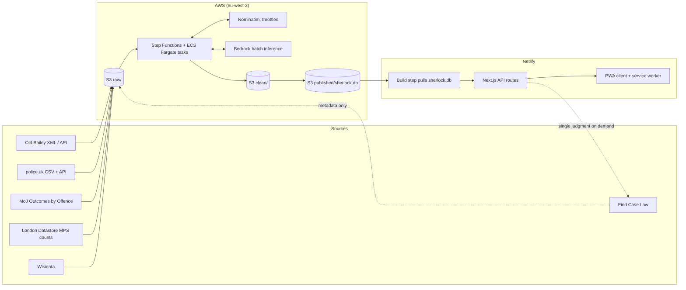

# Architecture: data pipeline

> **Status:** the police.uk pipeline for the City of London Police runs locally (see [Running the ETL locally](#running-the-etl-locally)). Everything else in this document, including the AWS deployment, is the agreed design but not built yet. The app still reads mock data (`src/lib/mock-data.ts`), not the database.

Sherlock never queries the upstream data sources while a user is browsing. A pipeline downloads each source, applies the data rules once, enriches the records (geocoding, AI summaries) and publishes a read-only database. The Next.js API routes only ever read from that database.

Why not query the sources live:

- **Rate limits.** The public Nominatim instance allows at most 1 request per second and forbids bulk geocoding. A single map view could need dozens of lookups.
- **Rules in one place.** The 100-year name rule, small-count suppression and "every case has a verdict and a source" are enforced at ingest and backed by database constraints, not re-checked on every request.
- **Joins and aggregates.** Then & Now compares historic and modern counts for an area, which needs data from several sources in one indexed store.
- **Cost and consistency.** AI summaries are generated once, reviewed and stored, not paid for on every page view.
- **Offline PWA.** Stable responses can be cached by the service worker.

## Overview



## Sources and how each is handled

| Source | Strategy | Refresh | Licence |
|---|---|---|---|
| police.uk street-level crime and outcomes (Metropolitan Police + City of London Police) | Full ETL, upsert by crime ID, aggregate to area counts | Monthly, after each release | Open Government Licence v3.0 |
| Old Bailey Proceedings, 1674–1913 | Full ETL from the XML dump; API for single-trial refetches | One-off; rebuild when transform code changes | Unconfirmed: the project docs say CC BY 4.0, but the Old Bailey licence page suggests commercial use needs permission. Confirm before any commercial use |
| MoJ Outcomes by Offence | ETL per release, stored as aggregates tagged with the release | Quarterly | Open Government Licence v3.0 |
| London Datastore: MPS Recorded Crime, Geographic Breakdown | ETL per release, stored as aggregates | Monthly | Open Government Licence (check version on the dataset page) |
| Find Case Law (The National Archives) | **Metadata only** (citation, URL, court, date). Judgment text is fetched on demand and cached briefly | On demand | Open Justice Licence v2.0. Bulk processing or AI summarising of judgments needs TNA's free computational-analysis licence first |
| Wikidata | ETL, keeping only statements that carry a reference URL | Monthly | CC0 |
| Court locations (MoJ) | ETL | Quarterly | Open Government Licence |

Sources we deliberately do not use: court hearing lists (they name people in cases that haven't concluded), news sites, Wikipedia article text, and crowd-sourced crime maps. None are primary records.

## Pipeline stages

Each source goes through three stages, stored under separate S3 prefixes:

1. **Raw** (`s3://…/raw/<source>/<retrieved_at>/`): downloaded files kept unchanged. The bucket is versioned, so any published row can be traced back to the exact file it came from.
2. **Clean** (`s3://…/clean/<source>/`): parsed, normalised and validated. Data rules are applied here (see below). Geocoding and AI summaries are added in this stage. Records that fail a rule are written to a rejects file with the reason, not silently dropped.
3. **Published** (`s3://…/published/sherlock-<version>.db`): a single SQLite file built from the clean stage, with indexes. This is the only thing the app reads.

Changing a rule re-runs the clean and publish stages only, without downloading everything again.

## Data rules enforced at ingest

These come from `.kiro/steering/tone-and-data-rules.md` and are checked in the clean stage, then repeated as `CHECK` / `NOT NULL` constraints in the published schema:

- Every case has a non-null `verdict` (or outcome) and a non-null `source_url`.
- Names (`defendant_name`, `victim_name`) are null for anything under 100 years old, unless the case is concluded (conviction recorded, sentence complete, no appeal pending) and has a verified source URL.
- Area counts of 1 or 2 are stored as null and shown as "a small number".
- An acquitted person is never stored or shown as a perpetrator.
- Every geocoded point stores its confidence: `exact`, `street` or `area`.

## Provenance on every row

Every table that holds a record from outside carries:

| Column | Purpose |
|---|---|
| `source` | e.g. `oldbailey`, `policeuk`, `findcaselaw` |
| `source_id` | Trial reference, police.uk crime ID or neutral citation |
| `source_url` | Link to the exact record |
| `licence`, `attribution_text` | Shown in the UI's source row |
| `retrieved_at` | When the raw file was downloaded |
| `upstream_version` | Release, ETag or file hash of the raw input |
| `transform_version` | Git SHA of the ETL code that produced the row |

AI summaries also store `model_id`, `prompt_version`, `generated_at` and `reviewed` (whether a person checked it). The UI labels them as AI-written.

## Refresh and removal

Court records and police outcomes change after publication: judgments are anonymised or withdrawn, and police.uk revises outcomes months later. A copy that never re-syncs could keep showing something the official source has removed, so:

- A scheduled job re-checks upstream IDs on every refresh. Records that have disappeared upstream are removed from the next published database, and the removal is logged.
- Find Case Law judgment text is never bulk-stored, so a withdrawn judgment stops appearing as soon as the on-demand fetch fails.
- The UI shows "source checked on …" from `retrieved_at`.

## AWS stack

The pipeline runs on AWS. The frontend stays on Netlify.

| Need | Service | Notes |
|---|---|---|
| Raw, clean and published storage | **Amazon S3** (versioned bucket, region eu-west-2) | Lifecycle rule moves old raw files to cheaper storage |
| Orchestration | **AWS Step Functions** | One state machine per source: download → clean → enrich → publish |
| ETL compute | **ECS Fargate** tasks running the same TypeScript scripts as local dev (`scripts/ingest-*.ts`) | Fargate rather than Lambda because geocoding at 1 request per second and parsing the Old Bailey dump exceed Lambda's 15-minute limit |
| Scheduling | **Amazon EventBridge Scheduler** | Monthly for police.uk and the London counts; quarterly for MoJ |
| AI summaries | **Amazon Bedrock**, using batch inference for the one-off Old Bailey run | Batch jobs are cheaper than per-request calls for bulk work. Bedrock is the only AI provider allowed by the steering rules |
| Geocoding | **Nominatim**, called only from the ETL, throttled to 1 request per second with a project User-Agent | Place strings are de-duplicated first, so each unique place is looked up once. For a large run, self-host Nominatim on a temporary EC2 instance instead of using the public service |
| Logs and run reports | **Amazon CloudWatch**, plus a per-run data-quality report (rows in, rows rejected and why) written to S3 | |
| Infrastructure as code | **AWS CDK** (TypeScript) | Same language as the app |

### Serving the data

The published database is a read-only SQLite file, which matches the existing spec and keeps hosting free of a database server:

- The Netlify build step downloads the latest `published/sherlock-<version>.db` from S3 using a read-only IAM user, and bundles it with the Next.js API routes.
- Map queries use an R*Tree spatial index; search uses SQLite FTS5; Then & Now reads pre-computed aggregate tables.
- A new data release means a new Netlify deploy, so the data version and the app version always match.

**When to move off SQLite:** if the file grows too large to bundle with the serverless functions, or the app ever needs to write data (saved cases synced across devices, corrections from users), move the published stage to **Aurora Serverless v2 for PostgreSQL with PostGIS**, reached from Netlify through the RDS Data API. The pipeline stays the same; only the publish step changes.

## Running the ETL locally

```bash
yarn ingest:police
```

That downloads the latest 12 months for the City of London Police into `data/raw/policeuk/`, builds `data/sherlock.db` and writes a run report to `data/reports/`. Useful flags:

| Flag | Effect |
|---|---|
| `--months 3` / `--month 2026-09` | Choose which months to load |
| `--force metropolitan --neighbourhoods <id>,<id>` | Another force, limited to some neighbourhoods |
| `--offline` | Rebuild from `data/raw` only, with no network calls |
| `--refresh` | Re-download raw files even if they are already saved |

```bash
yarn test:etl
```

That runs the transform tests (suppression, de-duplication, BTP attribution, rejects and provenance).

How the police.uk step works:

- Each police neighbourhood's boundary is used as the query polygon (`POST /api/crimes-street/all-crime`), so every count is tied to a force and neighbourhood.
- Crimes are de-duplicated by police.uk crime ID, because a street on a border can come back from two neighbourhoods.
- Counts are written at two levels, `street` and `neighbourhood`, and **counts of 1 or 2 are stored as `NULL` at both levels**. This is stricter than the steering rule (which allows small counts for wider areas) but matches the ingestion spec. Most street-level rows end up suppressed in the City (about 82% in the first run), so the app should show neighbourhood counts by default.
- Each run replaces the rows for the months it loads, so anything police.uk removes upstream also disappears here.
- `data/` is generated and ignored by git.

## Build order

1. **police.uk.** Done for the City of London Police, which covers Fleet Street and the Old Bailey itself. Next: Metropolitan Police neighbourhoods around the City, and the outcomes data.
2. **Old Bailey Proceedings.** The core historic layer. Parse the XML, de-duplicate place names, geocode, then run Bedrock batch summaries.
3. **MoJ Outcomes by Offence and London MPS counts**, for the Then & Now screen.
4. **Find Case Law metadata**, after deciding whether to apply for the computational-analysis licence.
